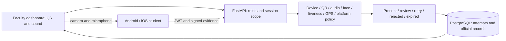

# Secure Presence Verification System (SPVS)

SPVS is a college attendance project that combines identity checks with physical
presence evidence. A FastAPI backend evaluates signed student submissions; a React
dashboard manages sessions and review; native Android and iOS apps collect evidence.
The repository name retains the historical “SVPS” spelling; the product is SPVS.

Static codes and manual registers can permit proxy attendance. SPVS combines
rotating QR, a short audible challenge, face matching, temporal liveness, device
keys, GPS and platform-specific Wi-Fi policy. Uncertainty produces review or retry.
It is a production-inspired academic implementation, not a certified anti-spoofing system.

## Current evaluation status

The latest user-reported Motorola Edge 50 Neo test passed login, QR, acoustic,
face and liveness, then was rejected outside the classroom from the hostel.
The iPhone 16 Pro passed login, QR and acoustic, then returned **Outside geofence**.
These are expected negative attendance tests, not successful classroom approvals.
iOS identity checks in this latest trial are not independently confirmed; older
24 October evidence is scoped separately. Genuine App Attest remains unverified.

See [fresh verification](SPVS_FINAL_VERIFICATION_REPORT.md),
[current status](docs/CURRENT_STATUS.md), and [remaining work](docs/EVALUATION_CHECKLIST.md).
Current-policy classroom approval, record creation and dashboard synchronization
still require an observed in-classroom trial. Earlier policy results are historical.

## Features and architecture

- Role-scoped accounts, courses, enrollment, classrooms and attendance sessions.
- Consent-based encrypted face templates; YuNet/SFace and MediaPipe temporal checks.
- Native P-256 device signatures, single-use challenges and idempotent submissions.
- Mandatory rotating QR and per-attempt audible challenge with server deadlines.
- GPS uncertainty/freshness checks; Android Wi-Fi scan and separate iOS policy.
- Explainable outcomes, disputes, audited corrections, reports and CSV export.



| Component | Technology |
| --- | --- |
| Backend | Python 3.11–3.12, FastAPI, Pydantic, SQLAlchemy, Alembic |
| Database | PostgreSQL 16 in Docker Compose |
| Identity | OpenCV YuNet/SFace, MediaPipe, Argon2id, JWT, cryptography |
| Dashboard | React, Vite, TypeScript, TanStack Query |
| Mobile | Expo 58, React Native 0.88, TypeScript, Kotlin and Swift modules |
| Validation | pytest, Vitest, Playwright, native Gradle/Xcode builds |

Locks live in [backend](backend/uv.lock), [dashboard](dashboard/package-lock.json)
and [mobile](mobile/package-lock.json). Android uses real scan observations;
iOS supports only a permitted current-network BSSID, not a nearby RSSI scan.
Expo Go cannot load the native modules. See [Android](docs/ANDROID_GUIDE.md)
and [iOS](docs/IOS_GUIDE.md) build instructions.

## Safe quick start: existing recovered environment

Install Docker Desktop, native ARM64 Python 3.12/uv and Node 22.12+ (24 recommended).
Keep existing private environment files. Confirm the host DATABASE_URL targets
the intended database, currently `spvs_recovery`. Do not run setup, seed or reset
against recovered data. From the repository root:

```sh
docker compose up -d db
make api
```

`make api` stays running. In a separate terminal run `make dashboard`; in a third:

```sh
cd mobile
npm start
```

The DB runs in the background; API, dashboard and Metro run in separate terminals.
API: port 8000, Swagger `/docs`, contract `/openapi.json`; dashboard: port 5173.
Set the private mobile EXPO_PUBLIC_API_URL to a phone-reachable address ending
in `/api/v1`. Local HTTP requires a development build configured with SPVS_DEV_HTTP=1.
Standalone release bundles require HTTPS. Never put secrets in EXPO_PUBLIC variables.

The Compose backend uses `SPVS_BACKEND_DB` (default `spvs`), independently of the
host DATABASE_URL. Before starting a container backend for recovered data, set
SPVS_BACKEND_DB=spvs_recovery locally and inspect the target. Do not run host and
container APIs on the same port. This audit did not restart or redeploy services.

## New installation only

In a fresh checkout with a new disposable database, `make setup`, `make db`,
`make migrate`, then `make seed` install dependencies/models, create the schema
and demonstration accounts. Read [setup](docs/SETUP_AND_DEMO_GUIDE.md) first.
The random demo password is private in the generated environment, never in this README.
Configure an explicitly designated demo room; never replace real C003 calibration.
Use [deployment guidance](docs/DEPLOYMENT_GUIDE.md) for TLS, backups and key handling.

## Demonstration and testing

Faculty opens a course session and starts challenges. The student logs in, scans
the rotating QR, listens while faculty plays the matching attempt, completes face
and liveness prompts, then submits location evidence. Record the actual decision
and gate. Only PRESENT creates automatic attendance; review/correction is distinct.
Follow the [demo guide](docs/EVALUATION_DEMO_GUIDE.md) for positive and negative cases.

Automated tests must use a disposable database ending in `_test`. Backend fixtures
truncate that database. Browser tests also modify classroom/session/policy data and
must use isolated services. Do not run them against the recovered runtime.
See [commands, counts and warnings](docs/TEST_RESULTS.md).

## Documentation

| Topic | Document |
| --- | --- |
| Full index and completion | [Project completion](docs/PROJECT_COMPLETION_STATUS.md) |
| Architecture and protocol | [Architecture](docs/SYSTEM_ARCHITECTURE.md), [QR/audio](docs/ACOUSTIC_DYNAMIC_QR.md) |
| API and schema | [API](docs/API_DOCUMENTATION.md), [database](docs/DATABASE_DESIGN.md) |
| Security | [Security architecture](docs/SECURITY_ARCHITECTURE.md), [threat model](docs/THREAT_MODEL.md) |
| Evaluation | [Demo](docs/EVALUATION_DEMO_GUIDE.md), [checklist](docs/EVALUATION_CHECKLIST.md) |
| Operations | [Troubleshooting](docs/TROUBLESHOOTING.md), [limitations](docs/KNOWN_LIMITATIONS.md) |
| Academic submission | [Report](docs/PROJECT_REPORT.md), [references](docs/REFERENCES.md) |

## Limitations and license

QR and audio can be relayed; GPS/Wi-Fi can be spoofed; device signatures do not
prove honest sensors. Biometric thresholds lack institutional calibration. Genuine
provider integrity, population accuracy, classroom throughput, retention automation
and production hardening remain open. BLE beacons are outside scope.

Source is under the [MIT license](LICENSE). Model licenses are retained separately
for [SFace](docs/LICENSE-SFACE.txt) and [YuNet](docs/LICENSE-YUNET.txt).
