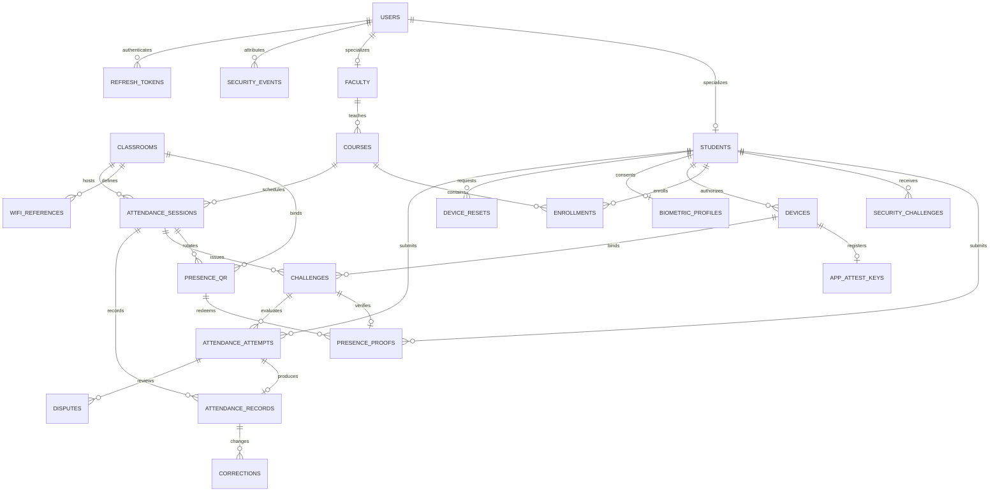

# Database design

## Current QR/audio migration

Migration `9bd32a88f101` adds presence_enabled/presence_epoch to attendance
sessions, a presence_qr table for rotating session/classroom/epoch-bound tokens,
and presence_proofs keyed by attempt challenge with QR verification, listening
readiness, hashed audio response, deadlines, consumption and idempotency state.
Unique QR/student redemption and row locks enforce the protocol. Existing
attempt/record history is retained; no raw audio column is introduced.

The migration maps legacy iOS gps_only policy to dynamic while retaining review
and retry. The local update used a private backup, preserved existing record counts
and C003 configuration, and passed the model-drift check. The schema diagram below
includes the policy-v2 and device-attestation relationships; [the generated table inventory](DATABASE_TABLE_INVENTORY.md) lists every current column and foreign key.

PostgreSQL 16 is used in Compose. The current model contains 24 application tables plus Alembic's version table (the initial migration created 20). IDs are application-generated UUID strings. Timestamps are timezone-aware. There are no raw-image columns.

| Table | Purpose / important constraint |
|---|---|
| users | Unique email, password hash, current role and active status |
| students | User FK and unique roll number |
| faculty | User FK and department |
| courses | Unique code, assigned faculty FK |
| enrollments | Composite primary key: course and student |
| classrooms | Unique name, latitude, longitude, radius |
| wifi_references | Unique classroom/BSSID and minimum RSSI |
| policies | Singleton verification settings |
| devices | Native public-key metadata or encrypted legacy shared secret; one active device per student |
| device_resets | Requested reason, status and administrator reviewer |
| biometric_profiles | Student primary key, encrypted template, model version, consent timestamp |
| attendance_sessions | Course/classroom FKs, start/end and explicit closure |
| challenges | Student/device/session bindings, purpose, random actions, expiry and used flag |
| attendance_attempts | Unique student/idempotency key, payload hash, decision, reasons and evidence summary |
| attendance_records | Unique student/session, optional attempt FK, status and source |
| security_events | Actor/session, severity, structured details and review flag |
| corrections | Record/actor FKs, previous/new status and mandatory reason |
| disputes | Student/attempt, reason, resolution and reviewer |
| refresh_tokens | Hashed random token, family, expiry, used and revoked flags |
| rate_buckets | Shared fixed-window counters keyed by account or connection source |

Verification locks the student row, then challenge and session, before consuming the challenge and writing the attempt/record. The same session row serializes a manual correction against verification. Device reset approval locks the student before revocation. A refresh-token rotation locks its token row; reuse revokes the entire refresh family. These transactions complement, rather than replace, unique constraints.

Subtype rows are retained when a current role changes because historical foreign keys must remain valid. Authorization always reads the current user role. Deleting referenced academic entities is intentionally restricted; deactivation and enrollment removal are supported while history remains attributable.

Location summaries retain coordinates rounded to three decimal places for coarse travel anomaly checks, plus distance, accuracy and age. Define an institutional retention schedule before deployment. The current application does not implement automated retention purges or an immutable external audit sink.

## Cross-platform completion update

Migrations `5c9d2a1e8b70` and `7a2d13ce4f90` add device key_algorithm/public_key/key_storage, policy ios_presence, security_challenges (user/device/purpose/nonce/expiry/used), app_attest_keys (globally unique key ID, unique device, public key, monotonic bigint counter/environment), and challenge enrollment_request_hash. Existing device rows default to legacy HMAC. The enrollment hash permits exact authenticated HTTP retries; different requests cannot replay a used challenge. Device and student locks serialize revocation/signature decisions. Raw camera frames are never stored in these tables.

## Safe operations and recovery

Migration chain: `3e61f3d2ac45` → `5c9d2a1e8b70` → `7a2d13ce4f90` →
`9bd32a88f101`. Inspect with `bash scripts/backend.sh alembic current`, `heads`,
and `check`. Fresh audit found the recovered database at head with no model drift.
Never apply a downgrade/reset/seed to recovered data for evaluation.

Before a future authorized migration, make a private custom-format pg_dump backup,
verify its inventory with pg_restore --list, and rehearse restoration into a new
disposable database. Restore into a new target, never over the recovered database;
keep original dumps immutable and private. Use a protected credential mechanism,
not passwords in command history. Verify revision, aggregate counts, constraints,
and application login before switching a private connection setting. Preserve
JWT/template encryption keys securely when restoring encrypted data.

The host uses DATABASE_URL. Compose's backend uses SPVS_BACKEND_DB at host `db`;
set it explicitly to spvs_recovery before opting into a container backend. Changing
POSTGRES_DB does not rename an existing database or restore data into a volume.
See [recovery incident](../SPVS_DATABASE_RECOVERY_REPORT.md).

Define retention for attempts, coarse locations, audit events, refresh tokens,
biometric consent/templates and backups. Encryption does not replace deletion and
access policy. Automated purges/key rotation are not implemented. Restrict database
roles, protect backup encryption keys, and test restoration periodically.
