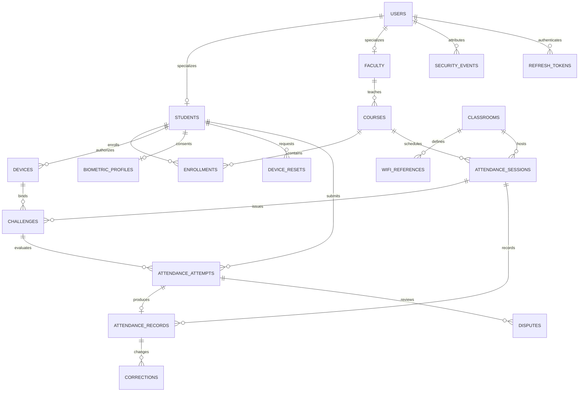

# Database design

PostgreSQL 16 is used in Compose. The initial migration creates 20 application tables plus Alembic's version table. IDs are application-generated UUID strings. Timestamps are timezone-aware. There are no raw-image columns.

| Table | Purpose / important constraint |
|---|---|
| users | Unique email, password hash, current role and active status |
| students | User FK and unique roll number |
| faculty | User FK and department |
| courses | Unique code, assigned faculty FK |
| enrollments | Composite primary key: course and student |
| classrooms | Unique name, latitude, longitude, radius |
| wifi_references | Unique classroom/BSSID and minimum RSSI |
| policies | Singleton verification settings |
| devices | Encrypted signing key; partial unique index allows one active device per student |
| device_resets | Requested reason, status and administrator reviewer |
| biometric_profiles | Student primary key, encrypted template, model version, consent timestamp |
| attendance_sessions | Course/classroom FKs, start/end and explicit closure |
| challenges | Student/device/session bindings, purpose, random actions, expiry and used flag |
| attendance_attempts | Unique student/idempotency key, payload hash, decision, reasons and evidence summary |
| attendance_records | Unique student/session, optional attempt FK, status and source |
| security_events | Actor/session, severity, structured details and review flag |
| corrections | Record/actor FKs, previous/new status and mandatory reason |
| disputes | Student/attempt, reason, resolution and reviewer |
| refresh_tokens | Hashed random token, family, expiry, used and revoked flags |
| rate_buckets | Shared fixed-window counters keyed by account or connection source |

Verification locks the student row, then challenge and session, before consuming the challenge and writing the attempt/record. The same session row serializes a manual correction against verification. Device reset approval locks the student before revocation. A refresh-token rotation locks its token row; reuse revokes the entire refresh family. These transactions complement, rather than replace, unique constraints.

Subtype rows are retained when a current role changes because historical foreign keys must remain valid. Authorization always reads the current user role. Deleting referenced academic entities is intentionally restricted; deactivation and enrollment removal are supported while history remains attributable.

Location summaries retain coordinates rounded to three decimal places for coarse travel anomaly checks, plus distance, accuracy and age. Define an institutional retention schedule before deployment. The current application does not implement automated retention purges or an immutable external audit sink.

## Cross-platform completion update

Migrations `5c9d2a1e8b70` and `7a2d13ce4f90` add device key_algorithm/public_key/key_storage, policy ios_presence, security_challenges (user/device/purpose/nonce/expiry/used), app_attest_keys (globally unique key ID, unique device, public key, monotonic bigint counter/environment), and challenge enrollment_request_hash. Existing device rows default to legacy HMAC. The enrollment hash permits exact authenticated HTTP retries; different requests cannot replay a used challenge. Device and student locks serialize revocation/signature decisions. Raw camera frames are never stored in these tables.
