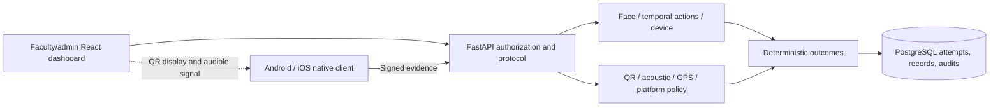

# Secure Presence Verification System

## 1. Title page

**A layered identity and classroom-presence verification system**

B.Tech final project report — evaluation checkpoint opened 28 October 2026.

Institution / department: **[To be completed by the submitting student]**

Student name(s) / roll number(s): **[To be completed]**

Supervisor / designation: **[To be completed]**

Academic year / semester: **[To be completed]**

Product abbreviation: SPVS. Repository:
[Secure-Presence-Verification-System-SVPS---Attendance-Software](https://github.com/Anishpantham/Secure-Presence-Verification-System-SVPS---Attendance-Software).
The inherited repository spelling differs from the product abbreviation.
This report does not imply institutional approval, deployment or certification.

## 2. Abstract

Attendance systems must reconcile identity, location, reliability and accountability.
A credential or shared code alone is insufficient evidence that the enrolled student
is present in the assigned classroom. SPVS implements a layered workflow in which
the backend evaluates a device-signed submission containing biometric and presence
evidence. The current protocol requires a rotating classroom QR token and a
per-attempt acoustic response, followed by face matching, temporal liveness,
location-quality evaluation and platform-specific presence policy.

The system comprises FastAPI services, PostgreSQL storage, a React faculty/admin
dashboard and native Expo/React Native Android and iOS clients. Transactions and
idempotency distinguish a genuine new submission from a network retry. Results
include present, rejected, review, retry and expired states, with explicit reasons.
Audited corrections support accountable human review.

Fresh automated checks are documented separately from user-reported phone trials.
The latest Android and iOS trials ended in expected outside-geofence rejection;
they do not establish legitimate classroom approval. The implementation demonstrates
layered verification and reproducible engineering, while population biometric
accuracy, relay resistance, genuine platform attestation and production readiness
remain unproven.

## 3. Introduction

Attendance records influence academic eligibility and disputes. Efficient capture
must therefore preserve attribution and provide an intelligible explanation when
evidence is insufficient. A mobile device offers camera, microphone and location
capabilities, but the server cannot assume that a client application or its operating
system is honest. SPVS treats submitted measurements as evidence to evaluate under
explicit rules rather than a client-declared successful result.

The project separates identity from physical presence while requiring both for
automatic approval. Institution-managed users and course scope connect verification
to an academic workflow. Reports and corrections make the result reviewable.

## 4. Problem statement

Manual registers permit proxy marks and require transcription. Static QR codes can
be forwarded. GPS uncertainty is substantial indoors, and face similarity alone
does not establish liveness. The problem is to combine fresh contextual evidence
without allowing a favorable score to override a failed mandatory gate, while
handling unreliable networks and maintaining an attributable record.

The system must not invent measurements when permissions or sensors fail. It must
also distinguish a rejected remote attempt from a validated legitimate attendance.

## 5. Objectives

1. Provide scoped student, faculty and administrator workflows.
2. Bind evidence to a registered device, challenge and active course session.
3. Evaluate consented face identity and temporal actions on the server.
4. Require fresh QR/acoustic exchange and evaluate GPS/platform evidence.
5. Prevent duplicate official records and support exact authenticated retries.
6. Preserve explainable attempts, disputes, corrections and audit events.
7. Deliver reproducible source, documentation and evidence without inflated claims.

## 6. Literature review and existing approaches

This is a qualitative review of engineering approaches, not a systematic literature
survey or comparative benchmark. Manual registers are accessible but weak against
proxy marking. Static tokens and QR systems reduce transcription but permit sharing.
Biometric-only approaches bind a claim to a face but require presentation-attack
evaluation. Location-only approaches depend on indoor signal quality and trusted
capture. Device signatures demonstrate possession of a key, not physical proximity.

OpenCV's face-recognition tutorial describes detection, alignment and feature
comparison [5–6]. MediaPipe provides facial landmark estimation [7–8], which SPVS
uses for temporal heuristics rather than certified liveness. Android documents
scan restrictions [12], while Apple and Google describe separate attestation
boundaries [13–14]. These sources motivate explicit platform differences and
limited assurance claims. No invented research paper or accuracy percentage is used.

## 7. Proposed system

Faculty creates an attendance session for an assigned course and configured room.
The student authenticates, obtains a challenge tied to the enrolled account and
registered device, scans a rotating QR, and listens for a per-attempt audible
response. After server redemption, the app captures face actions and location.
It signs exact evidence bytes for server evaluation.

Automatic PRESENT requires the implemented identity, device, session, time and
presence gates. Ambiguous or unavailable evidence may require review/retry. Manual
corrections are separate attributable actions; they do not rewrite an original
rejection as a successful automatic verification.

## 8. Requirements analysis

Functional requirements cover account/role management, courses/enrollment,
classrooms and Wi-Fi references, consented face enrollment, device registration,
session lifecycle, dynamic challenges, evidence evaluation, reports and disputes.
Nonfunctional requirements include input bounds, controlled access, privacy,
transactional consistency, reproducibility and understandable failure handling.

The backend supports Python 3.11–3.12 and PostgreSQL (16 in Compose). The dashboard
requires Node 22.12+ and a modern browser. Native builds require compatible Android
SDK/JDK or macOS/Xcode/CocoaPods. A real device must grant foreground sensor
permissions and reach the API. Model files and environment secrets are provisioned
locally. Production requires additional TLS, retention and operational policy.

## 9. System architecture

Synchronous handlers use SQLAlchemy sessions and run inference behind a per-process
lock. PostgreSQL coordinates cross-worker rate limits and critical row locks.
The dashboard uses a same-origin proxy; the mobile app calls a configured API URL.
The [architecture appendix](SYSTEM_ARCHITECTURE.md) contains the full sequence,
decision flow and retry semantics. BLE beacons are outside the implemented scope.

## 10. Technology stack

FastAPI/Pydantic validate requests; SQLAlchemy and Alembic implement persistence
and schema evolution. PostgreSQL supplies constraints and transactional locks.
YuNet detects faces, SFace produces 128-dimensional embeddings and MediaPipe supplies
landmarks. Argon2id hashes passwords; cryptography protects templates and verifies
native signatures. React/Vite/TanStack Query support staff workflows. Expo/React
Native shares mobile logic with Kotlin/Swift modules for keys, Wi-Fi and audio.
pytest, Vitest, Playwright, Gradle and Xcode provide distinct validation layers.

## 11. Database design

The current model has 24 application tables plus Alembic's version table. Accounts
and role subtypes link to courses/enrollment. Classroom references configure
location policy. Devices, biometric profiles and security challenges support
identity. Attendance sessions/challenges, presence QR/proofs, attempts and official
records separate evidence from outcome. Events, corrections and disputes preserve
review history. Hashed refresh tokens and rate buckets support authentication.

Foreign keys preserve attribution. Unique student/session records prevent duplicate
official attendance. A partial active-device index enforces ordinary device binding.
Presence proofs bind the challenge/student/QR and store audio hashes and deadlines,
not raw audio. The current migration is 9bd32a88f101. Full columns and relationships
are in [database design](DATABASE_DESIGN.md) and [table inventory](DATABASE_TABLE_INVENTORY.md).

## 12. Authentication and identity verification

Passwords use Argon2id. JWT validation checks algorithm, issuer, audience, expiry,
type and required claims; current role and active status are read from the database.
Refresh tokens are random, hashed, rotated and grouped into revocable families.
Logout revokes refresh sessions; already-issued access tokens retain a bounded
validity window unless account access is disabled.

Native P-256 registration proves possession using a one-use server nonce. Signed
requests cover the idempotency key and exact payload. Private keys remain in native
storage. Storage metadata is not provider attestation. Existing legacy HMAC devices
remain compatible during migration. Device replacement requires audited reset.

## 13. Presence verification

The backend calculates Haversine distance and checks measurement age, accuracy,
future timestamps and reported mock flags. A fully outside uncertainty circle
rejects; overlap with the boundary requests review. Stale or inaccurate readings
request retry. Absence of a mock flag is not proof of an uncompromised device.

Android matches actual observed BSSIDs/RSSI against references, requiring at least
half of configured references. Missing Wi-Fi follows explicit review/reject/GPS-only
fallback policy. iOS supplies at most current-network identity and applies its own
review/retry/dynamic policy. No nearby scan or RSSI is fabricated. Dynamic policy
requires QR/audio and all remaining gates; global integrity requirements still apply.

## 14. QR and acoustic mechanisms

Staff starts session challenges, incrementing a presence epoch. QR tokens are
session/classroom/epoch-bound, rotate every five seconds and expire within ten.
Student redemption is authenticated and device signed. The microphone is prepared
before signaling readiness; faculty selects the queued attempt for playback.

The audio response combines an attempt-routing tag with 64 unpredictable bits.
A 2.7-second audible FSK signal is decoded on the phone and submitted before a
five-second server deadline. Wrong or late answers are consumed. PostgreSQL locks
serialize playback reservations. Restarting challenges invalidates previous epochs.
Raw PCM remains transient on the device. Freshness reduces replay opportunity but
does not prove distance or prevent a sufficiently fast live relay.

## 15. Face recognition and liveness

YuNet requires a usable single face; aligned SFace features are normalized and
compared with an encrypted enrollment template. Enrollment checks cross-frame
identity before averaging. Attendance frames must match the reference threshold.
MediaPipe landmarks support blink transitions and stable head-turn observations.
Frames must be ordered and fall within the challenge interval.

Random actions and timing checks resist simple static submissions, but camera
provenance is not independently attested. The small action vocabulary, injected
frames, replay and deepfakes require adversarial testing. Public-portrait smoke
tests validate model execution, not demographic fairness, FAR/FRR or population accuracy.

## 16. Android implementation

The shared app orchestrates QR/audio, face capture, location and result/history
screens. SpvsSecurity uses Android Keystore; SpvsWifi collects real recent scans
subject to permissions and throttling; SpvsAcoustic supplies bounded microphone
capture. Camera, audio and precise location permissions are declared. Missing
signals have explicit failure states. SecureStore holds tokens and device metadata.

The latest user-reported Motorola Edge 50 Neo trial passed authentication, QR,
acoustic, face and liveness, then rejected attendance from the hostel. Classroom
acceptance and independent Wi-Fi discrimination under policy v2 remain pending.

## 17. iOS implementation

Swift modules implement Secure Enclave keys on physical devices, current-network
information when entitled, App Attest calls and acoustic capture. Simulator keys
use Keychain and must not be described as Secure Enclave evidence. iOS has no
Android-style nearby Wi-Fi scan. Xcode team/provisioning, precise location,
microphone, camera and Local Network permissions are operational requirements.

The user reports successful Homebrew CocoaPods setup, native installation on
iPhone 16 Pro, login, QR and acoustic checks, followed by Outside geofence.
Latest-trial face/liveness and genuine App Attest are not independently confirmed.
Older 24 October evidence records identity/liveness with review, and is not reused
as proof of the new trial or current-policy classroom approval.

## 18. Attendance decision engine

Authentication and signature failures produce HTTP errors. Eligible attributable
submissions produce stored attempts. The engine evaluates session/challenge/device,
identity, GPS/platform policy and dynamic proof, checks expiry before approval,
consumes the challenge and atomically inserts an attempt and optional official record.
Only PRESENT creates automatic attendance. Review, retry, rejected and expired
outcomes remain visible without inserting an approved record.

Exact idempotent retries return the prior attempt; changed evidence with the same
key conflicts. Session locking also serializes correction against verification.
Numerical risk is explanatory and cannot override mandatory gates. A review
submission caused by failed QR/audio explicitly records identity NOT_COMPLETED.

## 19. Security analysis and threat model

The threat model includes proxy marking, QR sharing, acoustic relay, location/Wi-Fi
spoofing, compromised or shared devices, presentation attacks, token theft and
network interception. Defenses combine scope, freshness, signatures, rate limits,
transactional replay controls, model evaluation and audited review. They do not
establish absolute protection against colluding attackers or a compromised OS.

App Attest verification logic is exercised with synthetic provider material; genuine
Apple interoperability is outstanding. Play Integrity remains unconfigured.
HTTPS, restricted operations, protected keys/backups and institutional retention
are required outside local development. See [security architecture](SECURITY_ARCHITECTURE.md),
[threat model](THREAT_MODEL.md) and [fresh security report](../SPVS_SECURITY_TEST_REPORT.md).

## 20. Implementation details

Pydantic bounds structured input and signed evidence. Body/image limits constrain
resource use. Public projections suppress password hashes, template ciphertext
and secret/token hashes. The API contains 54 documented operations. Most success
responses currently lack explicit response_model schemas; this contract gap is
documented rather than inventing typed responses.

The dashboard provides scoped forms, empty/loading/error states, session QR/audio,
records and CSV export. The mobile state machine stops foreground capture on
interruption, preserves exact submissions for uncertain transport retries and
explains definitive failures. Source locations are linked in the API inventory.

## 21. Testing methodology

Validation separates backend unit/database/API/security tests, real-model smoke
tests, client logic/UI tests, isolated browser integration, native compilation
and physical-device observations. Backend API transaction cases substitute vision
to isolate persistence; real-model cases separately execute actual inference.
Neither substitutes for live presentation-attack testing.

The current audit uses a newly created disposable database named
spvs_audit_20261028_test. Destructive fixtures never target spvs_recovery. Browser
services use separate ports and the same disposable database. Checks and exact
exit codes are retained in [test results](TEST_RESULTS.md). No test was weakened
to obtain a passing result. Native builds do not establish sensor correctness.

## 22. Results and discussion

Fresh execution passed 234 tests: 146 backend (including seven real-model cases),
64 mobile, 11 dashboard, 10 native Wi-Fi and 3 isolated browser tests, with zero
final failures or skips. The linked test ledger records commands and warnings. The recovered database was inspected
read-only at migration head with four users and two historical official records.
Those counts do not prove a new policy-v2 approval.

The latest physical observations establish successful reported dynamic exchanges
and expected outside-geofence decisions. They support a negative-test demonstration,
not classroom acceptance or platform-integrity verification. Older C003 approval
predates the dynamic protocol. No latency, biometric accuracy percentage, adoption
rate or throughput benchmark is fabricated. Open dependency findings and manual
gates limit readiness despite automated success.

## 23. Limitations

QR/audio can be relayed; sensor inputs can be forged on compromised devices;
biometric thresholds lack institutional calibration. Audio serialization and
CPU inference may limit capacity. GPS/Wi-Fi are approximate. iOS capabilities
depend on entitlement/provisioning and policy. Provider integrity, classroom
positive validation and automated retention remain open. The academic title-page
metadata must be completed by the student. Detailed limits are in
[known limitations](KNOWN_LIMITATIONS.md).

## 24. Future enhancements

Priorities are independent classroom positive/negative trials, fresh Wi-Fi boundary
sampling, current iOS identity/policy evidence, provider attestation, compatible
dependency fixes and operational privacy controls. Subsequent work may add typed
response contracts, pagination, load measurement, protected external audit export,
key rotation, institutional identity integration and accessibility evaluation.
These are proposed extensions, not completed features.

## 25. Conclusion and references

SPVS implements a coherent layered attendance workflow with explicit uncertainty
and accountable review. Source inspection and executed tests support functional
implementation claims. User-reported outside trials support expected rejection
claims. Current classroom approval, provider integrity and production effectiveness
require additional evidence. Evaluation should therefore present the implemented
system, the measured checks and the remaining gates together.

The bibliography is [References and provenance](REFERENCES.md), items 1–20.
Official documentation and model/sample provenance are implementation references;
they are not experimental results from SPVS. Source is MIT licensed, with separate
model licenses retained in the repository.

## 26. Appendices

- [Architecture and verification sequence](SYSTEM_ARCHITECTURE.md).
- [Database entities, migrations and recovery](DATABASE_DESIGN.md).
- [API reference](API_DOCUMENTATION.md) and [all operations](API_ENDPOINT_INVENTORY.md).
- [Fresh test ledger](TEST_RESULTS.md) and [final verification](../SPVS_FINAL_VERIFICATION_REPORT.md).
- [Android](../SPVS_ANDROID_VALIDATION_REPORT.md), [iOS](../SPVS_IOS_VALIDATION_REPORT.md),
  [cross-platform](../SPVS_CROSS_PLATFORM_TEST_REPORT.md) and [recovery](../SPVS_DATABASE_RECOVERY_REPORT.md) reports.
- [Demo procedure](EVALUATION_DEMO_GUIDE.md), [evaluation checklist](EVALUATION_CHECKLIST.md)
  and [release readiness](../SPVS_RELEASE_READINESS_REPORT.md).

The Markdown source is authoritative for diagrams and links. Dated PDF/DOCX
exports accompany this checkpoint; historical release archives remain historical.
