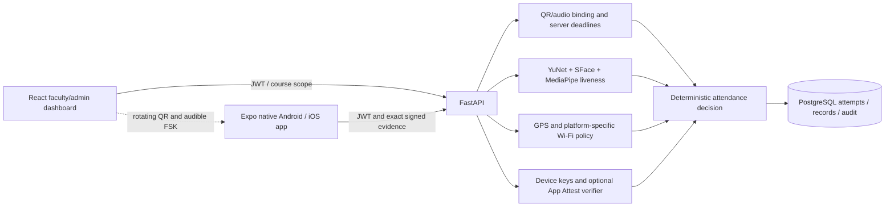
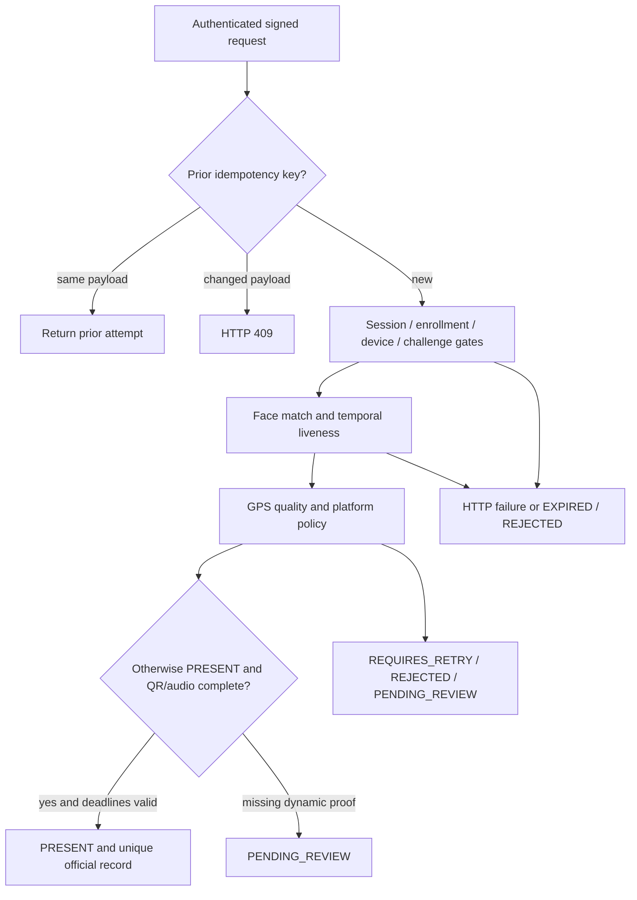

# System architecture

Current protocol: policy v2, migration 9bd32a88f101. Diagrams describe implemented
logic; physical effectiveness and deployment maturity are separate claims.



## Backend and persistence

FastAPI synchronous handlers use SQLAlchemy transactions. Role dependencies and
course/enrollment checks run server-side. PostgreSQL shares rate buckets and row
locks across workers; inference uses a process-local lock and CPU model instances.
Multiple workers duplicate model memory; throughput is not measured.
See [database design](DATABASE_DESIGN.md) for 24 tables and schema relationships.

Authentication uses Argon2id, short-lived HS256 JWTs and hashed rotating refresh
tokens. New devices register a nonce-bound P-256 proof. Legacy HMAC devices remain
compatible. App Attest verifies configured provider material; Play Integrity is
an unconfigured fail-closed adapter. Neither login nor key-storage metadata proves
hardware integrity.

## Student and faculty sequence

```mermaid
sequenceDiagram
  participant F as Faculty dashboard
  participant M as Native student app
  participant A as FastAPI
  participant DB as PostgreSQL
  F->>A: Start active session challenges
  A->>DB: Increment presence epoch
  F->>A: Poll display (rotating QR)
  M->>A: Request bound attendance challenge
  M->>A: Signed QR redemption
  M->>A: Signed ready after microphone setup
  F->>A: Play queued attempt
  A-->>F: Per-attempt audio payload / five-second deadline
  F-->>M: Audible 2.7-second FSK signal
  M->>A: Signed decoded response
  A->>DB: Consume answer / persist verified proof
  M->>M: Face/liveness frames, GPS and platform evidence
  M->>A: Signed attendance request with idempotency key
  A->>DB: Lock student, device, challenge and session
  A->>A: Identity, platform integrity and presence evaluation
  A->>DB: Consume challenge; persist attempt and optional record
  A-->>M: State / reasons / evidence summary
```

QR rotates every five seconds and lasts at most ten. The audio answer includes
an attempt tag and 64 unpredictable bits; one wrong/late answer burns redemption.
Session epoch changes invalidate proofs. Server time is sampled after locking.
These freshness controls do not prove distance and cannot exclude live relay.
See [protocol](ACOUSTIC_DYNAMIC_QR.md).

## Decision and failure handling



The UI collects QR/audio before face capture. The server computes dynamic-proof
status, evaluates identity/location when eligible, and prevents any provisional
PRESENT without complete dynamic proof. It does not skip every expensive identity
check merely because QR/audio is missing. Expiry is checked again before approval.
Capture-failure submissions create review attempts with identity NOT_COMPLETED.

Exact signed enrollment/attendance retries recover uncertain network responses.
Changed evidence must not reuse the idempotency key. Definitive 4xx failures lead
to a new allowed attempt; network/5xx may retain the request. Challenges and attempt
limits still apply. Manual correction is explicitly sourced and auditable; resolving
a dispute alone does not create attendance.

## Client architecture and platform differences

Dashboard TanStack Query calls scoped APIs through Vite/nginx. Tokens stay in memory.
ClassroomChallenges polls QR/queue, handles empty/error state and uses browser audio
only after a user interaction. Five-second reservations serialize the channel.

Mobile adapters separate native keys, permissions, scan and audio from shared UI.
ClassroomPresence tracks preparation, QR, listening, decoded response and review;
foreground interruption stops capture. SecureStore holds tokens and key metadata.
Private keys remain native. Frames are transient and uploaded for inference; raw
PCM remains on-device. Failed capture is visible, never invented as successful evidence.

Android supplies timestamped Wi-Fi scans subject to OS throttling and permissions.
iOS supplies at most permitted current-network BSSID. Its review/retry/dynamic
policy is independent of Android fallback policy; dynamic still requires identity,
device, GPS and QR/audio. Geofence boundary uncertainty goes to review; old or
inaccurate positions request retry. A fully outside uncertainty circle rejects.
