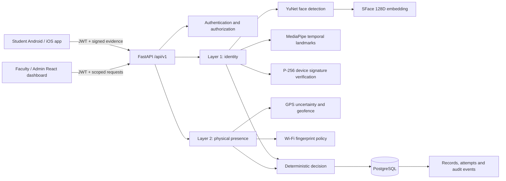
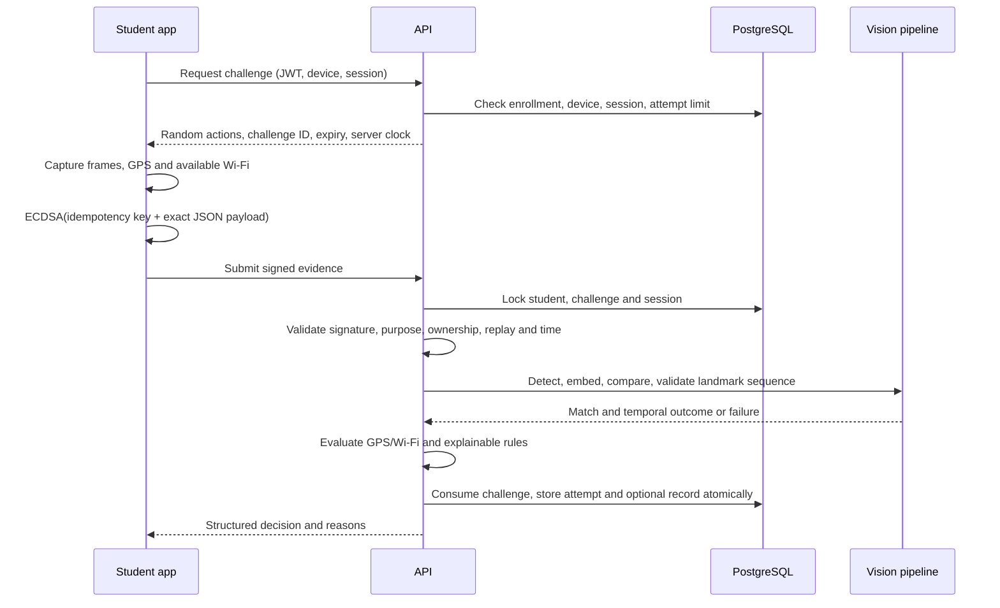
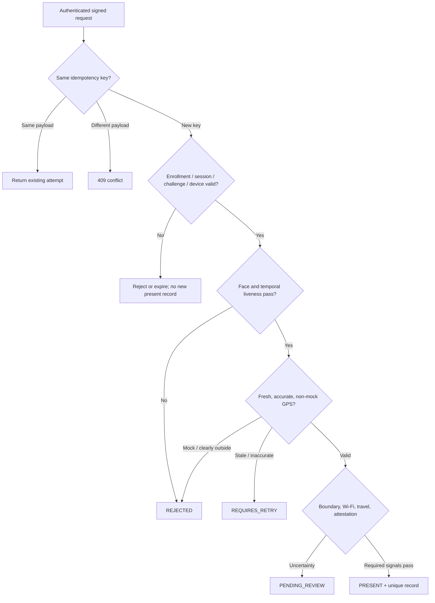

# System architecture

## Component architecture

The backend uses synchronous SQLAlchemy sessions in FastAPI synchronous route handlers, which execute in the framework's thread pool. This is deliberate: OpenCV/MediaPipe inference is synchronous and guarded by a process-local model lock. The application does not block an async endpoint with a synchronous database call. Multiple API workers share PostgreSQL rate limits and locks; each worker has its own model memory. Capacity and fair scheduling require load testing before institutional deployment.

The dashboard uses a same-origin `/api` route through Vite in development or nginx in containers. Tokens remain in dashboard memory. The mobile app stores tokens and per-user key metadata in SecureStore; new private keys stay in native Keystore/Secure Enclave storage. Its camera cache files are deleted after conversion; no raw frames are saved by the backend.

## Verification sequence

## Decision flow

Authentication, malformed payload and signature failures are HTTP errors; signed, attributable verification outcomes are persisted as attempts. This distinction prevents unauthenticated requests from inventing someone else's attempt history.

## Cross-platform completion update

Native device keys now live in `spvs-security` (Kotlin/Swift), with shared TypeScript adapters. App Attest registration uses dedicated one-use security challenges; assertions bind the exact signed request and advance a PostgreSQL counter. iOS current-network evidence is separate from Android scan measurements. See CROSS_PLATFORM_IMPLEMENTATION.md for trust boundaries and native-build limits.
